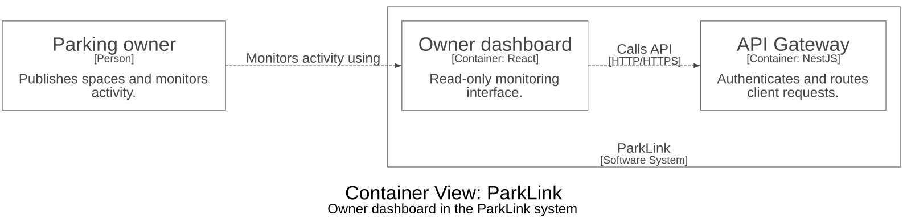

# ParkLink Web

La aplicación web actual de ParkLink es un panel de solo lectura para que los propietarios consulten su actividad.

## Responsabilidades

- Consulta información para propietarios a través de la pasarela.
- Actualmente no reemplaza los flujos de publicación ni de reserva de la aplicación móvil.

## Tecnologías

React, TypeScript y Vite.

## Arquitectura C4

El diagrama muestra una **vista de contenedores C4** centrada en este componente y sus relaciones relevantes. Se genera desde [Structurizr DSL](docs/architecture/workspace.dsl) con los estilos predeterminados, sin colores personalizados. Las flechas indican la dirección de cada interacción. El diagrama se conserva en inglés.



Para consultar o regenerar el diagrama, abra `docs/architecture/workspace.dsl` en Structurizr. Con Structurizr CLI y Graphviz instalados:

```sh
structurizr.sh validate -workspace docs/architecture/workspace.dsl
mkdir -p /tmp/parklink-diagram
structurizr.sh export -workspace docs/architecture/workspace.dsl -format dot -output /tmp/parklink-diagram
dot -Tsvg /tmp/parklink-diagram/structurizr-Containers.dot -o docs/architecture/containers.svg
```

## Compilación en el espacio integrado

```sh
npm ci
npm run build -w @parklink/owner-dashboard
```

## Relación con el proyecto

Este repositorio es una copia independiente de `apps/owner-dashboard` en [parklink-platform](https://github.com/1ASI0728-2620-16363-ParkLink/parklink-platform). Use el espacio integrado para la configuración npm, las dependencias compartidas, el contexto de Docker, las pruebas y la infraestructura local. Los repositorios no se sincronizan automáticamente.
